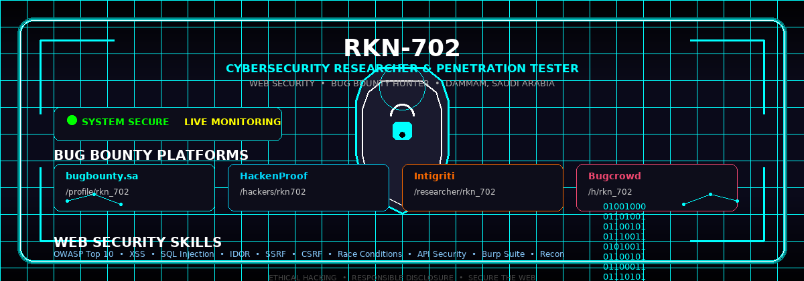

<!-- skin:start -->

<!-- skin:end -->

  

  

  <b>Penetration Tester &amp; Cybersecurity Researcher</b> · Hunting vulnerabilities and securing web applications.

## 👋 About Me

I'm **RKN**, a cybersecurity researcher and penetration tester based in Dammam, Saudi Arabia. I specialize in **web application security** and **bug bounty hunting** — finding vulnerabilities, reporting them responsibly, and helping organizations build more secure systems.

- 🔭 I’m currently hunting on **Bugbounty.sa, HackenProof, Intigriti, and Bugcrowd**
- 🌱 I’m currently learning **advanced web exploitation, API security, and cloud security**
- 👯 I’m looking to collaborate on **security research, CTFs, and open-source security tools**
- 💬 Ask me about **web penetration testing, vulnerability assessment, and secure coding**
- 📫 How to reach me: **[rkn@example.com](mailto:rkn@example.com)** · [LinkedIn](https://www.linkedin.com)
- ⚡ Fun fact: I enjoy breaking things (ethically) to help make the web a safer place.

## 🎯 Bug Bounty Platforms

  
  
  
  

## 🛠️ Security Skills & Tools

  

  
<b>Web Security &amp; Penetration Testing Toolkit</b>

| Category | Tools & Techniques |
|----------|-------------------|
| **Web Vulnerabilities** | OWASP Top 10 · XSS · SQL Injection · IDOR · SSRF · CSRF · Open Redirect · Race Conditions |
| **Recon & Discovery** | Subdomain enumeration · Directory busting · Parameter discovery · Technology fingerprinting |
| **Burp Suite** | Repeater · Intruder · Collaborator · Scanner · Extensions (BApp Store) |
| **API Security** | REST/GraphQL testing · JWT analysis · Authentication bypass · Rate limiting bypass |
| **Network & System** | Nmap · Nessus · Metasploit · NSE scripts · Port scanning · Service enumeration |
| **Programming** | Python · Go · JavaScript · Bash scripting for automation & tool development |
| **Platforms** | Bugbounty.sa · HackenProof · Intigriti · Bugcrowd · HackerOne · CTF platforms |

## 📊 GitHub Stats

  
  

  

## 🏆 Bug Bounty Achievements

<table>
  <tr>
    <td width="33%">
      <b>🇸🇦 Bugbounty.sa</b> 
      <a href="https://bugbounty.sa/profile/rkn_702" target="_blank">View Profile</a>
    </td>
    <td width="33%">
      <b>🛡️ HackenProof</b> 
      <a href="https://hackenproof.com/hackers/rkn702" target="_blank">View Profile</a>
    </td>
    <td width="33%">
      <b>🎯 Intigriti</b> 
      <a href="https://app.intigriti.com/researcher/profile/rkn_702" target="_blank">View Profile</a>
    </td>
  </tr>
  <tr>
    <td width="33%">
      <b>🐛 Bugcrowd</b> 
      <a href="https://bugcrowd.com/h/rkn_702" target="_blank">View Profile</a>
    </td>
    <td width="33%">—</td>
    <td width="33%">—</td>
  </tr>
</table>

## 🚀 Featured Security Projects

<table>
  <tr>
    <td width="50%">
      
    </td>
    <td width="50%">
      
    </td>
  </tr>
</table>

> Explore more of my work and security research in the **Repositories** tab.

## 📈 Activity

  

## 🤝 Let's Connect

  
  
  
  

  

  <b>Thanks for visiting my profile!</b> 🔐 Stay secure, stay curious.

<!--
**RKN-702/RKN-702** is a ✨ _special_ ✨ repository because its `README.md` (this file) appears on your GitHub profile.
-->
